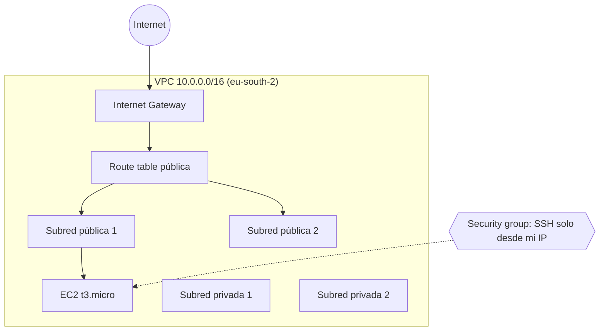

# aws-terraform-lab

Infraestructura base en AWS con Terraform: red segmentada y una instancia EC2 con configuración segura por defecto.

## Arquitectura

## Qué incluye

- VPC con 2 subredes públicas y 2 privadas en 2 zonas de disponibilidad
- Internet Gateway y tabla de rutas para las subredes públicas
- Security group con SSH restringido a una única IP (variable `mi_ip`)
- EC2 Amazon Linux 2023 con **IMDSv2 obligatorio** y **disco cifrado**
- Sin NAT Gateway a propósito, para mantener el coste en cero

## Cómo reproducirlo

1. Instalar Terraform y AWS CLI, y ejecutar `aws configure`
2. Generar una clave SSH: `ssh-keygen -t ed25519 -f ~/.ssh/aws-lab`
3. Crear `terraform.tfvars` con `mi_ip = "TU_IP/32"`
4. `terraform init && terraform apply`
5. `ssh -i ~/.ssh/aws-lab ec2-user@$(terraform output -raw ip_publica)`
6. Al terminar: `terraform destroy`

## Seguridad

- El `tfstate` y los `tfvars` están en `.gitignore`
- Acceso por usuario IAM (no root) y MFA en la cuenta
- Mejoras previstas: política IAM de mínimo privilegio, estado remoto en S3 con bloqueo, CloudTrail y GuardDuty
